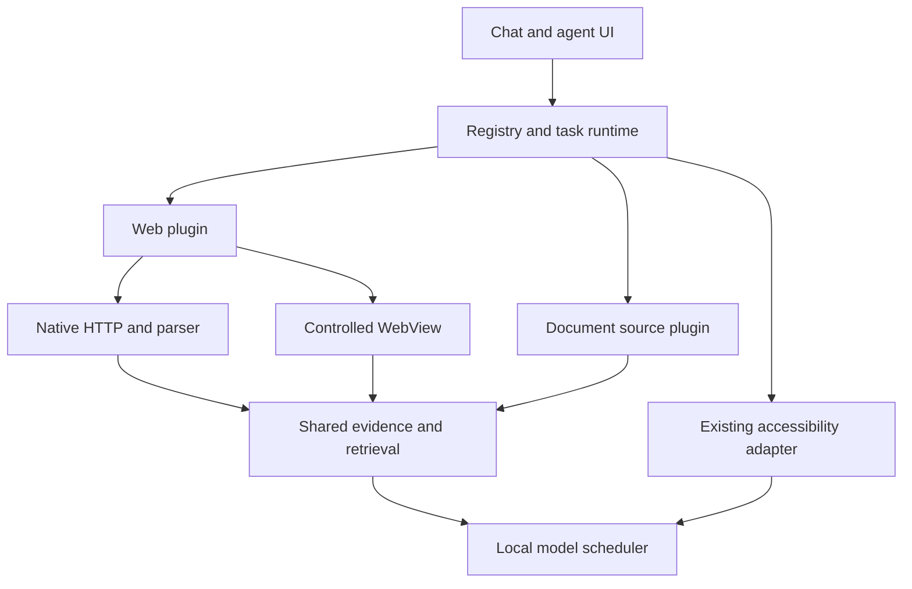

# Modular web agent and RAG architecture

Status: proposed design, 28 November 2026. No application implementation is included in this document.

The initial chat/LiveTalk integration is now implemented on `feat/modular-web-agent`. See [web-agent-implementation.md](web-agent-implementation.md) for its actual API, setup, validation and remaining release gates. This architecture includes later phases that are not yet implemented.

Reviewed baseline: `fix/background-agent-runtime`, commit `5db7ec3e6d8d1472a15798468b89b3cb96775498`.

## 1. Decision and limits

Build an Android-first, on-device web agent. Use native HTTP for fetching, HTML parsing for extraction, a controlled WebView for pages that need JavaScript, shared local retrieval, and the existing local model for planning and answers. No paid search, scraping, embedding, or generation API is required for this path.

The production contract is **fresh information from accessible sources, with provenance and explicit failure states**. It is not guaranteed access to every website, continuous background operation, or unrestricted free search at any scale.

Millions of installations can perform their own bounded requests without a central browser farm. This moves compute, bandwidth, battery use, and storage to devices; it does not make those resources free. Website capacity, blocks, permissions, maintenance, application distribution, and model distribution remain constraints. A shared search engine, browser fleet, or caching backend would introduce operating costs. Free public endpoints are not a dependable production infrastructure commitment.

Assume the current Android app and an 8 GB physical-RAM target. iOS would need its own native execution and browser adapters before equivalent functionality is advertised.

## 2. Findings in the current project

| Current component | Observed behavior | Integration decision |
| --- | --- | --- |
| `src/agents/agentOrchestrator.ts` | Registry exists, but constructor registers AccessibilityAgent and routing falls back to it. | Retain existing behavior through a legacy adapter; introduce explicit capability routing for new plugins. |
| `src/agents/agentRuntime.ts` | Every task starts the accessibility foreground service and claims the model for the task duration. | Web retrieval must have an independent lifecycle and acquire inference access only when needed. |
| `src/agents/types.ts` | Actions, observations, and step records describe Android UI interaction. | Add generic task events and artifacts alongside these types; do not immediately rewrite old persisted records. |
| `src/services/documentService.ts` | Native extraction, page/paragraph chunking, and synchronous per-query ranking. | Wrap extraction and retrieval behind stable source and retriever interfaces. Keep the existing caller compatible during migration. |
| `src/utils/BM25.ts` | Lightweight BM25-style ranking; ASCII-oriented tokenization; zero matches return the first chunks. | Preserve a compatibility adapter initially. Introduce Unicode-aware retrieval and explicit no-evidence results behind the new path. |
| `src/screens/HomePage/HomePage.tsx` | Attachment handling invokes document processing, selects context, and constructs the generation prompt directly. | Move evidence assembly into a service incrementally, keeping attachment, image, audio, and ordinary chat behavior covered. |
| Native DocumentProcessor | Supports PDF/OCR and Office extraction. Cancellation is global, and supplied options are not currently applied. | Serialize shared processing initially. Enforce request limits and cancellation ownership before accepting untrusted web documents. |
| Native LLM and LiveTalk | Shared engine ownership and native cancellation checks protect concurrent users. | Keep those protections. Generalize lease authorization deliberately; do not bypass accessibility checks to make web generation work. |

The document chunker can also retain an oversized page or paragraph, and context assembly can include an oversized first chunk. New chunking and packing must have enforceable limits, not just approximate character targets.

Prior validation recorded 67 passing Jest tests and a passing TypeScript check. Android native compilation and physical-device validation remain required release gates; those results do not establish native runtime correctness.

## 3. Components and ownership



An agent coordinates a task. A tool is a bounded function such as fetching a URL. RAG handles evidence storage, selection, and context construction. Keep these responsibilities separate so a future RSS, calendar, or database plugin can reuse them without implementing another agent loop or vector database.

Suggested new ownership boundaries:

| Location | Owns |
| --- | --- |
| `src/agentCore/` | Contracts, registry, routing, task lifecycle, resource leases, events, permissions, budgets |
| `src/rag/` | Source contracts, normalization, chunking, index adapters, retrieval, context packing, citation mapping |
| `src/plugins/registerPlugins.ts` | The only composition point that references plugin folders |
| `src/plugins/web/` | Manifest, tools, web task policy, extraction strategies, optional UI, fixtures and tests |
| `src/plugins/documents/` | Adapter around current document processing and retrieval |
| `src/plugins/accessibility/` | Adapter around the existing accessibility implementation |
| Shared native capability modules | HTTP, browser, persistent indexing and job execution; versioned TurboModule interfaces |

Do not move existing accessibility implementation files merely to match this layout. The adapter can delegate to their existing paths.

## 4. One-call plugin installation and removal

The intended composition API is:

```ts
registerPlugin('documents', () => import('./documents'));
registerPlugin('accessibility', () => import('./accessibility'));
registerPlugin('web', () => import('./web'));
```

Removing web support means deleting its registration line and `src/plugins/web/`. This is a source-level change followed by a new app build. It is not remote native-code installation or an over-the-air native removal mechanism.

Each plugin exports a manifest and factory. The manifest declares its ID, contract version, tools and their input/output schemas, required capabilities, optional source providers, execution requirements, and namespaced storage ownership. Registration must finish before routing tasks; expensive resources initialize only when required. Duplicate IDs, tool-name conflicts, or incompatible contracts fail registration clearly.

Tools use a common function contract, conceptually:

```ts
type Tool<I, O> = {
  name: string;
  inputSchema: JsonSchema;
  outputSchema: JsonSchema;
  execute(input: I, context: TaskContext): Promise<O>;
};

type TaskContext = {
  taskId: string;
  signal: AbortSignal;
  deadlineMs: number;
  capabilities: ScopedCapabilities;
  budgets: TaskBudgets;
  emit(event: TaskEvent): void;
};
```

`ScopedCapabilities` exposes only declared, authorized operations. Plugins do not import another plugin, mutate global Redux directly, call the model outside its scheduler, or access native modules through unscoped escape routes. Validate model tool arguments at runtime; TypeScript alone is insufficient. Core code owns tool dispatch, argument validation, cancellation, and budgets. Disallow arbitrary JavaScript execution suggested by the model.

The UI reads registered tool and agent metadata. Persisted jobs store plugin ID, tool ID, schema version, and JSON arguments rather than closures or class names. Core jobs and events stay generic. This avoids a switch statement, reducer, worker class, or UI import that must be edited for every agent.

Removal behavior must be part of the design:

- Unregistered tools disappear from routing, prompts, and UI automatically.
- Tasks targeting a removed plugin become `capability_unavailable`; never reroute them to AccessibilityAgent.
- Cancel queued work owned by missing plugins during registry reconciliation. Native workers require a registry snapshot matching the installed app version; a missing/stale snapshot pauses work until bootstrap.
- Keep previous user-visible task history readable using generic records. Expire or delete plugin cache/index entries through a core namespace cleanup policy. Do not depend on calling a deleted plugin's cleanup function.
- Keep plugin tests and optional UI inside its folder. Add a build check that removes web registration and excludes its folder, then verifies type checking, bundling, and app startup.

**Boundary:** one-line removal applies to plugins built on already-installed shared capabilities. A future plugin that introduces a new native SDK, manifest permission, Gradle dependency, or iOS dependency also needs native installation/removal work. Removing the web plugin can leave a shared, dormant browser capability installed; removing that capability from the binary is a separate operation.

## 5. Web acquisition and actual browsing

Expose a small initial tool surface: `web.read`, `web.open`, `web.links`, `web.follow`, `web.extract`, and `web.close`. Add `web.search` only when a discovery provider is configured. `web.read` can use HTTP first and escalate to a browser session when necessary.

### Static pages and downloads

Use a scoped native HTTP client, preferably the app's compatible OkHttp dependency, with streaming responses. Parse HTML with jsoup after fetching through the controlled transport. jsoup is an MIT-licensed parser with Android support, subject to its documented Java/desugaring requirements.

Preserve headings, paragraphs, lists, tables, links, and relevant structured metadata. Prefer a verified domain extractor when present, then a generic content extractor. Schema.org/JSON-LD is useful but remains untrusted site content; it may be stale or disagree with the visible page. Preserve those disagreements rather than silently choosing a value.

Do not strip HTML using regular expressions or send full HTML into the model. Return bounded structured artifacts and references to native files across the bridge. Detect challenge pages, login screens, consent gates, empty content, and truncation; a successful HTTP status is not successful extraction.

PDFs use the existing processor only after downloaded-file size, format, page, memory, and cancellation limits are enforced. Do not feed HTML directly through the current document plain-text path as a substitute for web extraction.

### JavaScript-dependent pages

Provide a native browser surface behind a React Native component, using Fabric-compatible integration and TurboModules for supported control operations. Validate any wrapper dependency against RN 0.87 before selecting it. Manage WebView creation, lifecycle, renderer failure, and destruction on the appropriate native threads.

The agent can open a page, inspect a bounded DOM snapshot, follow observed links, scroll to reveal content, and extract supported structures. References include navigation and snapshot IDs so a command cannot act on an element from an old page. Use bounded DOM stabilization and explicit content predicates; do not rely on a fixed sleep or wait forever for network-idle on pages with analytics or streaming connections.

Initial browser scope is public, signed-out content and navigation. Do not expose purchase, message-send, upload, or account-changing tools through this plugin. Login/CAPTCHA challenges require user participation; a failed challenge is a supported outcome. JavaScript pages can themselves generate network side effects, so a navigation-only agent is not a guarantee that the website is side-effect-free.

Use a visible browser session for interactive rendering. When the app backgrounds or the renderer becomes unavailable, checkpoint and return `requires_foreground` for that stage. Do not build reliability around an invisible WebView running indefinitely in a service.

### Discovery is separate

Recommended sources are user URLs, shared browser links, chosen websites, discovered links within the task budget, and permitted RSS/Atom feeds or domain-specific feeds. Cache sitemaps only when needed; do not crawl entire domains by default.

Broad search requires its own replaceable provider. Public SearXNG instances and scraped search result pages are best-effort dependencies. SearXNG's own documentation describes upstream CAPTCHA and blocking. Self-hosting adds infrastructure and maintenance, and does not remove upstream limits. A supported alternative is a user-visible search session followed by reading selected pages.

When no reliable discovery provider exists, direct browsing remains available. Report `search_unavailable` or ask for a URL rather than inventing URLs or answers. Search snippets help find pages; factual answers use fetched page evidence.

## 6. Modular RAG and evidence

Use independently replaceable source adapters, chunkers, index stores, retrievers, optional rerankers, and context packers. The model consumes an `EvidenceBundle`; it does not need to know whether a chunk came from a document or website.

Pipeline: acquire a source, normalize it, make bounded chunks, index atomically, retrieve under source/session permissions, optionally rerank, pack to the model budget, generate, and validate citation IDs. Ingestion and retrieval are separate operations: downloading a page does not require owning the model.

Start with the current ranker behind a compatibility interface. For a persistent multi-source corpus, use a bundled SQLite build with verified FTS5 support; do not assume every supported Android OS SQLite provides the desired extension. FTS5 provides BM25 ranking. Validate English, Hindi, mixed-language text, URLs, numbers, and tables with the chosen tokenizer. Index once per content version instead of re-tokenizing every stored document on every question.

Introduce optional on-device embeddings behind an `EmbeddingProvider` only after retrieval evaluation justifies them. Record embedding model ID, version, dimensions, and chunker version. A model change requires a separate index or controlled re-indexing. Hybrid lexical/semantic retrieval can combine rank positions; do not add incompatible raw scores. No external vector database or paid embedding API is necessary.

Do not load another large model alongside Gemma, LiveTalk, and WebView by default. Schedule indexing when resources permit; generation and user interaction take precedence over background enrichment.

Store, at minimum:

| Record | Required fields |
| --- | --- |
| Source | Source ID, plugin ID, session/user scope, requested URL, final URL, title, language, MIME type |
| Version | Content hash, extraction version, fetch time, validation time, optional published/updated time, ETag, Last-Modified, cache policy |
| Chunk | Chunk ID, source version ID, text, heading/page/table location, offsets, token estimate, extraction warnings |
| Evidence | Selected chunk IDs, retrieval method/ranks, freshness state, task ID, source errors and truncation |
| Job | Plugin/tool version, arguments, state, attempt count, deadline, resource requirements, checkpoints |

Keep raw cache files separate from indexed text and enforce a combined disk quota. Use transactions so an interrupted index write cannot mix partial old/new versions. Scope private sources to their originating user/session; retrieved web text must not cause unrelated private notes to be searched or sent to a website. Derived indexes inherit retention rules. Provide delete controls that remove source files, chunks, embeddings, and queued work.

The context budget must account for system prompt, tool schemas, conversation, question, evidence, and reserved output. Do not equate 1,500 characters with a guaranteed token count, particularly for Hindi. Use the model tokenizer where available; otherwise conservative language-aware estimates and strict limits. Split oversized pages and paragraphs. For summarization, explicitly sample or process sections; do not disguise the first few chunks as relevance matches.

Answers use stable citation IDs mapped by the application to real source URLs and locations. Validate that every cited ID was provided to the model. Citation existence does not prove that a claim is supported: evaluate claim support separately and show insufficient evidence when appropriate. An optional verification pass may improve quality but is not a correctness guarantee.

## 7. Freshness and real-time behavior

Define real-time here as fresh retrieval when the user asks, as far as the source exposes current data. It is not a promise of push updates or guaranteed second-by-second prices, scores, or availability.

Use HTTP cache semantics, ETag/Last-Modified conditional revalidation, and per-source freshness requirements. Keep `fetchedAt`, `validatedAt`, and publisher timestamps separate. A freshly downloaded old article is still an old article. Preserve the exact source version supporting an answer.

For a request using words such as latest/today/current, fetch or revalidate required evidence before answering. If that fails, either clearly label a cached result with its observation time or report that the current value could not be verified. Never silently label stale results as live. Conflicting sources should retain their dates and attribution.

Respect `no-store` for the HTTP cache; use an equally conservative retention policy for derived RAG content unless the user separately saves it under an appropriate policy. Use short-lived in-memory evidence for such responses. Do not persist browser cookies, authentication material, or full browsing history in task logs.

## 8. Background execution and resource ownership

| Work | Execution policy |
| --- | --- |
| Active foreground question | Immediate bounded task; acquire native resources only for the needed stage |
| Deferrable fetch/index/cache cleanup | Native WorkManager job with network, storage, battery, deadline and retry constraints |
| Long user-initiated operation | Use an eligible foreground execution mechanism with visible notification and Stop; review service type and OS restrictions for the actual operation |
| JavaScript rendering or human login | Foreground browser session; checkpoint when UI becomes unavailable |
| Existing Android app control | Existing accessibility lifecycle, screen-lock checks and cancellation gates remain active |

WorkManager periodic work has a 15-minute minimum interval and inexact timing. Android 16 can apply job quotas even to long-running workers using foreground services. A foreground service is not an unlimited availability guarantee. Force-stop and device restrictions must be reflected honestly in task status.

Keep durable downloading/parsing/indexing in native workers rather than requiring a JavaScript timer or mounted React screen. Store stable operation descriptors and artifact IDs. If React Native/model execution is unavailable, finish the safe acquisition stage and defer answer generation. Resume idempotent read/index operations only; browser steps require a fresh snapshot. Do not automatically replay side-effectful actions after process death.

The shared model scheduler remains the sole inference owner. A web task may fetch while another feature owns the engine, then wait for a generation lease. It must not preempt an active chat/LiveTalk session or steal an accessibility task's model. Cancel underlying HTTP calls and pending leases promptly when Stop is pressed; prevent late callbacks from reviving a cancelled task.

Native agent authorization currently depends on accessibility service state. Introduce scoped execution leases that preserve those checks for accessibility and apply the appropriate policy to web inference. Merely disabling that native gate would create a regression.

## 9. Reliability, security and scale controls

Initial limits are tunable defaults to validate on the target phone, not measured capacity claims:

| Resource | Starting policy |
| --- | --- |
| Concurrent HTTP requests | 2 per device, 1 per origin |
| Concurrent browser sessions | 1 |
| Pages per task | 5, with at most 2 link hops |
| Per-request deadline | 20 seconds, including a total-task deadline |
| Acquisition deadline | 90 seconds; inference has its own bounded deadline |
| HTML body | 2 MiB decompressed maximum; separate tested limits for PDFs |
| HTTP redirects | At most 5, all revalidated |
| Retries | At most 2 retries for eligible transient/idempotent failures; honor Retry-After and task deadline |
| Local cache/index | Initial combined 100 MiB quota; user-adjustable and eviction-aware |

WebView has subresources beyond the top-level document; an HTTP body limit alone does not bound its memory or traffic. Apply renderer lifetime limits, resource filtering, memory/thermal checks and renderer termination. Defer expensive work during LiveTalk or low-memory conditions.

Use jittered backoff, per-origin circuit breakers, duplicate-request coalescing, content deduplication, and capped queues. Do not retry CAPTCHA, login, forbidden access, invalid input, or unsupported content as transient network failures. Return structured outcomes such as `blocked`, `authentication_required`, `requires_foreground`, `timeout`, `cancelled`, `unsupported`, `partial`, and `no_evidence`.

Security requirements for this feature:

- Validate schemes, ports, credentials, DNS results and every redirect. Block loopback/private/link-local/metadata destinations for automatic public-web HTTP retrieval, including IPv6 and DNS-rebinding cases. Ensure the transport connects only to the validated destination; URL-string checks alone are insufficient.
- Keep TLS verification enabled. Disable arbitrary external intents, file/content access, uploads, downloads outside the app cache, camera/microphone/location requests and navigation to unapproved schemes.
- Never expose a general `addJavascriptInterface` bridge to arbitrary web content. Use narrowly scoped native extraction callbacks with origin/navigation validation. Do not render unsanitized extracted HTML in the app UI.
- Start automated JavaScript rendering with tested origins. WebView navigation/interception callbacks are not a complete network firewall; unrestricted rendering must remain gated until subresource and redirect protections are demonstrated. Do not claim complete private-network isolation from a top-level URL allowlist.
- Treat page content, structured metadata, PDFs and tool results as untrusted data. Instructions embedded in them cannot authorize tool calls, change the user's task, grant capabilities, or request private context. Enforce this in the dispatcher as well as prompts.
- Honor publisher access rules and robots directives for automated crawling, use domain budgets, and do not bypass authentication, paywalls or CAPTCHA. Robots rules are not an access permission grant.
- Log task IDs, stage durations, bytes, error categories and cache results. Redact page bodies, queries with personal data, tokens, cookies and private URLs. Keep diagnostics local by default; optional aggregate telemetry needs an explicit privacy and operating-cost decision.

Device-local rate limits cannot enforce a global limit across a million devices. Avoid scheduled mass crawling and synchronized polling. High-volume publisher integrations eventually need source agreements and potentially shared coordination. As an illustrative workload, 1 million daily users making 2 tasks of 3 pages at 300 KB per page produce about 1.8 TB/day of aggregate page transfer, before browser subresources. Device distribution removes a central transfer bill for that path, not the traffic itself.

## 10. Delivery sequence and release gates

| Phase | Deliverable | Gate before proceeding |
| --- | --- | --- |
| 1. Compatibility foundation | Plugin contracts, single composition root, generic task/artifact records, legacy adapters, feature flag default off | Existing tests and TypeScript pass; native build established; no changes to existing routing when web is disabled |
| 2. Shared RAG boundary | Source/retriever/context interfaces; existing document facade preserved; Unicode and bounded chunking introduced with explicit evaluation | Document Q&A, summaries, English/Hindi, large pages, no-match and cancellation cases pass |
| 3. Direct web reading | Controlled HTTP, extraction, caching, citations, public URL entry, persistent source index | Fixture-based extraction/security tests; current-data failures and stale results correctly represented |
| 4. Interactive browsing | Native browser surface, DOM observations, link navigation, tables, foreground handoff | Renderer crash, rotation, background/foreground, login wall and navigation-race tests on devices |
| 5. Background hardening | Native jobs, stage checkpoints, resource scheduling, removal reconciliation | Process death, Stop, offline recovery, force-stop behavior, low storage/memory, and model contention tests |
| 6. Discovery and rollout | Optional provider adapters and supported-domain policies | Coverage and failure rates measured per provider/site; controlled rollout after baseline and new gates pass |

Validate native debug and release builds, lint/security checks appropriate to the changed modules, and real devices across the supported Android range. Specifically exercise the 8 GB target phone with model loaded, LiveTalk active, Hindi TTS, and a complex page. Check UI at phone and tablet widths.

Use deterministic local HTTP/browser fixtures for HTML, malformed markup, redirects, delayed DOM, tables, PDF, oversized/decompression payloads, 304/cache headers, rate limits, prompt injection, and private-network redirects. Evaluate extraction correctness, evidence relevance, citation validity and claim support with a maintained English/Hindi query set. Track p50/p95 stage latency, memory, battery and bytes; set shipping thresholds from these measurements and the supported-domain matrix rather than inventing a universal success percentage.

Non-regression checks cover ordinary chat streaming/cancellation, image/audio attachments, document processing, model switching/downloads, LiveTalk interruption/TTS, accessibility screen-lock protection and Stop behavior, history restore, and plugin removal. Do not ship until native/model lifecycle checks pass; Jest alone cannot validate these guarantees.

Keep new tables and record versions additive during rollout. Preserve old readers/facades and the web-off fallback until migration is verified. A local feature switch can disable new routing immediately; a remote fleet kill switch would require a separately secured delivery mechanism and operating decision.

## 11. Reference material

Repository observations are from the reviewed commit, particularly `agentRuntime.ts`, `agentOrchestrator.ts`, `types.ts`, `documentService.ts`, `BM25.ts`, `HomePage.tsx`, the DocumentProcessor spec/module and the existing model/runtime integration.

- [Android: long-running workers and Android 16 job quotas](https://developer.android.com/develop/background-work/background-tasks/persistent/how-to/long-running)
- [Android: work requests and periodic scheduling](https://developer.android.com/develop/background-work/background-tasks/persistent/getting-started/define-work)
- [Android: WebView native bridge security](https://developer.android.com/privacy-and-security/risks/insecure-webview-native-bridges)
- [Android: WebViewClient interception API](https://developer.android.com/reference/android/webkit/WebViewClient)
- [jsoup: parser, license and Android setup](https://jsoup.org/)
- [SQLite FTS5 and BM25](https://www.sqlite.org/fts5.html)
- [SearXNG limiter and upstream blocking](https://docs.searxng.org/admin/searx.limiter)
- [RFC 9111: HTTP caching](https://www.rfc-editor.org/rfc/rfc9111.html)
- [RFC 9309: robots exclusion protocol](https://www.rfc-editor.org/rfc/rfc9309.html)

These sources establish platform/library behavior. Resource limits, module boundaries, rollout order and product scope above are proposed engineering decisions that require implementation and validation.
